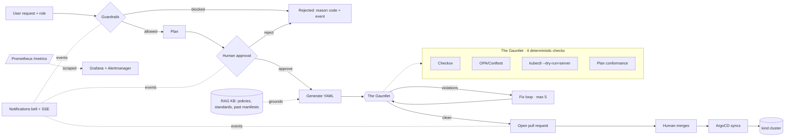

# NL2Infra

[](https://github.com/angelina10504/NL2Infra/actions/workflows/ci.yml)

Turn a plain-English infrastructure request — *"deploy an nginx app to dev with 2 replicas"* —
into safe, compliant Kubernetes YAML, **without the AI ever touching the cluster**.

> **Core rule (never broken): the LLM has no tools. It only produces text.** Everything it writes
> is checked by deterministic rule engines and only deployed after a human merges a pull request
> (GitOps with ArgoCD).

Everything runs on one laptop: a kind cluster in Docker, the Groq model `openai/gpt-oss-120b` (or
any configured model), local JSON run logs, and a local observability stack — zero cloud cost.

---

## Architecture



The pipeline is a fixed-order LangGraph:
`guardrails → plan → human approval → generate → validate (Gauntlet) → fix-loop (≤5) → open PR`.

## Repository layout

| Path | What |
|------|------|
| `contracts.py` | Pydantic data contracts (`RunState`, `Plan`, `Resource`, `Violation`) |
| `src/nl2infra/guardrails.py` | Deterministic input checks: scope, injection, roles, rate limit |
| `src/nl2infra/graph.py` / `pipeline.py` | The LangGraph pipeline and its driver |
| `src/nl2infra/validators.py` | The Gauntlet (Checkov, OPA/Conftest, dry-run, plan conformance) |
| `src/nl2infra/llm_service.py` | The **only** code that calls the model (text in, text out) |
| `src/nl2infra/notifications/` | Event bus + JSONL store + SSE for the dashboard bell |
| `src/nl2infra/metrics.py` | Prometheus metrics exposed at `/metrics` |
| `src/nl2infra/rag/` | Retrieval over policies, standards and past manifests |
| `src/nl2infra/server.py` | FastAPI app + HTML dashboard (`templates/index.html`) |
| `src/nl2infra/app.py` | Streamlit run/replay analysis UI |
| `policies/` | Rego policy packs (`base`, `staging`, `production`) + tests |
| `benchmarks/` + `eval/` | 4-arm benchmark runner, dataset (30 + 40), evaluation and charts |
| `observability/` | Prometheus + Grafana + Alertmanager, fully file-provisioned |

## Quick start

```bash
# 1. Python 3.12+, then install deps
python -m pip install -r requirements.txt

# 2. Configure (copy the example and fill in a key, or stay in mock mode)
cp .env.example .env
#    MOCK_MODE=true needs no API key and no cluster — great for a first run.

# 3. Run the dashboard (FastAPI + HTML, with the live notification bell)
python -m uvicorn server:app --app-dir src/nl2infra --port 8000
#    open http://localhost:8000

# 4. Or the Streamlit run/replay UI
python -m streamlit run src/nl2infra/app.py
```

For a **real** run (not mock), set `MOCK_MODE=false` and a `GROQ_API_KEY`, and install the Gauntlet
tools + a kind cluster:

```bash
bash setup_env.sh          # installs uv, kind, kubectl, conftest (checkov comes via pip)
make cluster namespaces    # kind cluster + dev/staging/production namespaces for the dry-run
```

## Running the tests

```bash
MOCK_MODE=true pytest -q            # ~257 tests, no network, no cluster
conftest verify --policy policies   # 33 Rego policy tests (needs conftest)
```

Tests that need the real scanners/cluster are marked `real_tools` and skip automatically when the
binaries are absent.

## Observability (Prometheus + Grafana)

```bash
# with the app running on :8000
docker compose -f docker-compose.observability.yml up -d
```

- Grafana: http://localhost:3000 — the **NL2Infra Overview** dashboard is pre-provisioned
  (success rate, requests over time, fix-loop rounds, violations by tool, blocked requests by reason,
  token usage, p95 duration, pending approvals).
- Prometheus: http://localhost:9090 · Alertmanager: http://localhost:9093.
- Alerts (low success rate, escalation spike, stale approvals) are posted back to the app at
  `/alerts/webhook`, so system-health alerts also appear in the dashboard bell.

## Notifications

The dashboard has a bell with an unread count, a colour-coded panel, live toast pop-ups over
Server-Sent Events, and **Approve / Reject buttons directly on approval events**. Events are also
available over the API: `GET /events`, `POST /events/{id}/read`, `POST /events/read-all`,
`GET /events/stream` (SSE). Channels are pluggable (`register_channel`) — email/Slack can be added
later without touching the pipeline.

## RAG

Before generating, the pipeline can retrieve the most relevant policies and a past approved manifest
from a local knowledge base (Rego/Checkov rules + `docs/standards.md` + approved run logs) and add
them to the prompt. Embeddings are offline TF-IDF over a FAISS index by default (set
`NL2INFRA_EMBEDDINGS=hf` for sentence-transformers). A retrieval Q&A bot answers *"why was my request
blocked or changed?"* at `POST /api/why`.

## Benchmark & evaluation

Four arms, same model and same Gauntlet: **A** plain call · **B** rules in the prompt · **C** full
pipeline · **D** full pipeline + RAG.

```bash
python benchmarks/run_benchmark.py --dry-count                 # offline: shows the call budget
python benchmarks/run_benchmark.py --yes --repeats 3 --arm all # arms A,B,C (needs a key + tools)
python benchmarks/run_benchmark.py --yes --repeats 3 --arm D   # arm D (RAG)
python eval/evaluate.py --runs runs/benchmark                  # results table + guardrail rates
python eval/charts.py   --runs runs/benchmark --out results/charts
```

See [`results/README.md`](results/README.md) for the real, reproducible guardrail numbers and an
honest note on what still needs a credentialed run.

## GitOps & ArgoCD

NL2Infra opens a pull request in a **separate manifests repository** (templated in
[`manifests-repo-template/`](manifests-repo-template/)); a human merges it and ArgoCD syncs it to the
kind cluster. `dev`/`staging` auto-sync, `production` is a manual promotion. Full setup — manifests
repo, `GITHUB_TOKEN`/`MANIFESTS_REPO`, ArgoCD install and the per-environment `Application`s — is in
[`docs/gitops.md`](docs/gitops.md). Without a token, the pipeline falls back to writing manifests
locally, so it still works offline.

## CI

GitHub Actions runs on every PR: ruff lint, the full pytest suite, the 33 Rego tests, Checkov on
sample manifests, and an offline smoke benchmark. A separate **advisory** job posts an AI-written
risk summary as a PR comment — it can only comment; it never approves or merges.

## Screenshots

Capture these once the app is running (and drop them in `docs/screenshots/`):

- the dashboard with the notification bell + a live toast (`GET /`),
- an `approval_required` card with Approve / Reject,
- the Grafana **NL2Infra Overview** dashboard (`http://localhost:3000`).

## Roles

| Role (canonical) | Legacy alias | May submit? | Environments |
|------------------|--------------|-------------|--------------|
| `viewer` | — | no (read-only) | — |
| `developer` | `junior_dev`, `senior_dev` | yes | `dev`, `staging` |
| `admin` | `platform_admin` | yes | `dev`, `staging`, `prod` |

## Ethics and limits

- **The LLM has no tools, no credentials and no cluster access.** It only emits text. Every artifact
  is checked by deterministic engines and a human before anything is applied.
- **Human approval is mandatory.** Nothing is generated before a plan is approved, and nothing is
  applied before a person merges the pull request. ArgoCD, not the model, syncs the cluster.
- **Two layers, two jobs.** Input guardrails stop prompt injection, privilege escalation, off-topic
  and direct-cluster-access attempts. The Gauntlet stops unsafe *manifests* (privileged containers,
  hostPath, `:latest`, missing limits, wrong apiVersion, plaintext secrets). Neither claims to do the
  other's job — see `results/README.md` for the honest refusal-rate breakdown.
- **What it cannot catch:** logic that is compliant but wrong for the business; novel attack phrasings
  the keyword/role checks miss (mitigated by the downstream Gauntlet and human review); issues the
  scanners themselves don't encode; and anything outside Kubernetes YAML. Treat the AI output as a
  draft for review, never as an authority.

## Tier 2 — production design (sketch)

This repo targets a single laptop. A production deployment would keep the same "LLM has no tools"
core and swap the substrate:

- **Cluster:** managed Kubernetes (EKS/GKE/AKS) instead of kind; ArgoCD unchanged.
- **State:** Postgres for run logs and events (not JSONL); object storage (S3) for manifests/artifacts.
- **Queue:** Redis/SQS for the fix-loop and benchmark work so the API stays responsive.
- **Secrets:** a secrets manager (Vault / cloud KMS) instead of `.env`; per-user OIDC auth and real RBAC.
- **Observability:** the same Prometheus/Grafana/Alertmanager, scraped cluster-side with long-term storage.
- **Scale:** the LLM service behind a rate-limited gateway; the Gauntlet as a horizontally-scaled worker pool.
